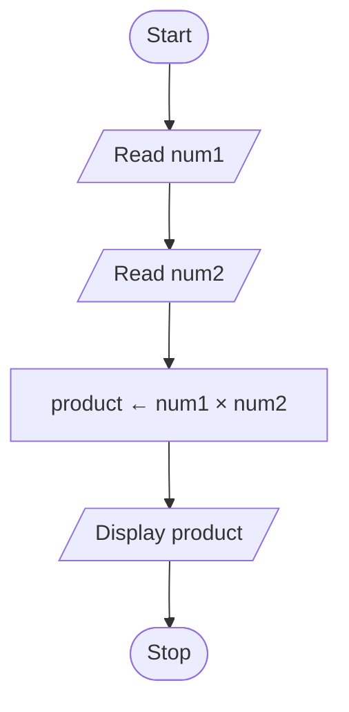
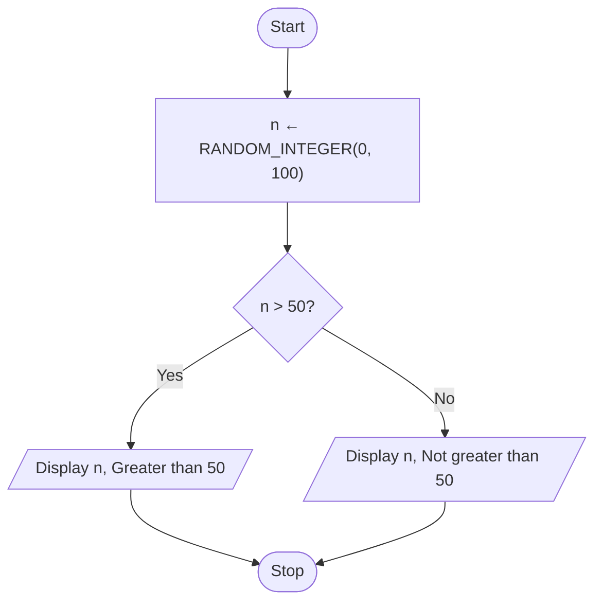
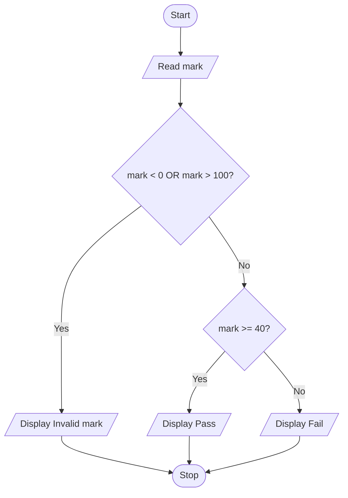
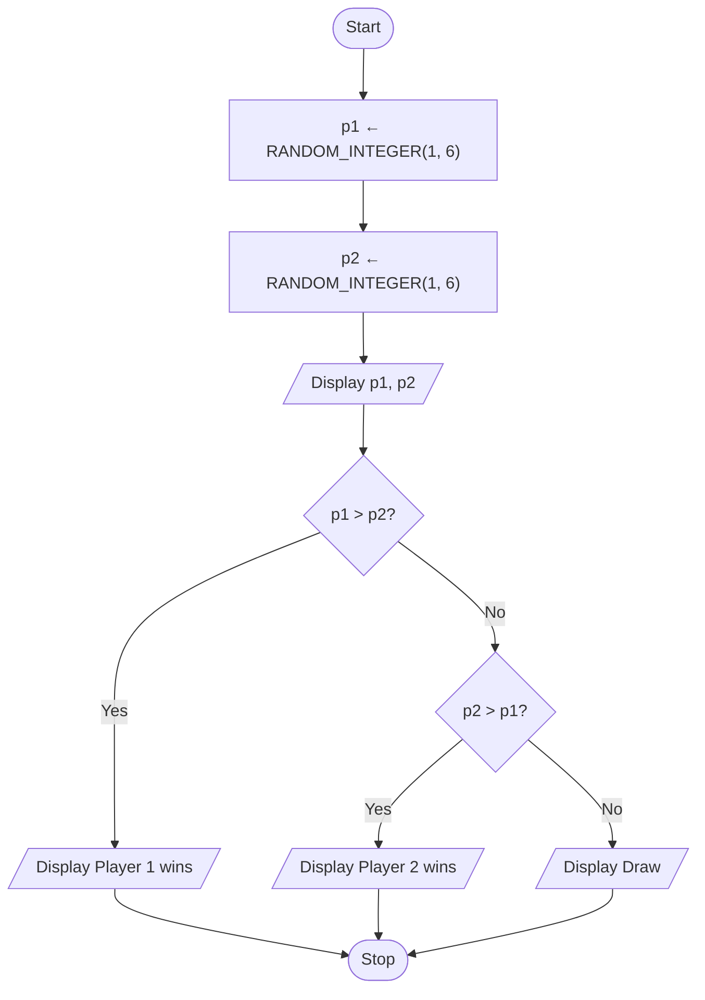
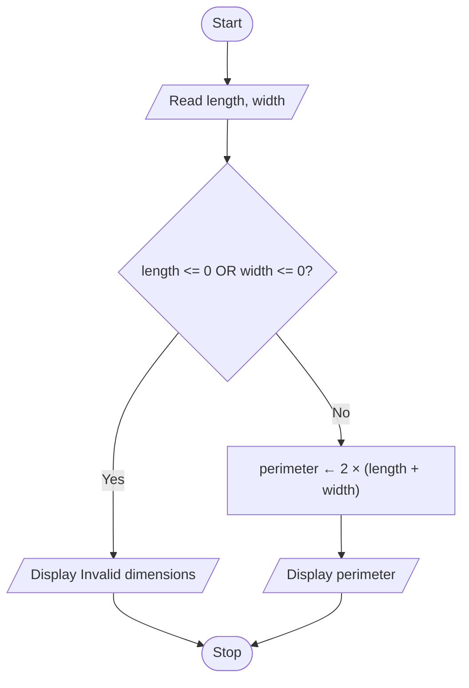
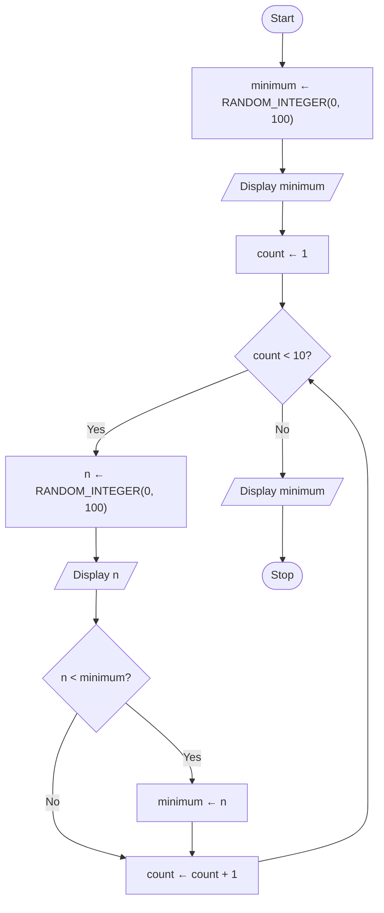
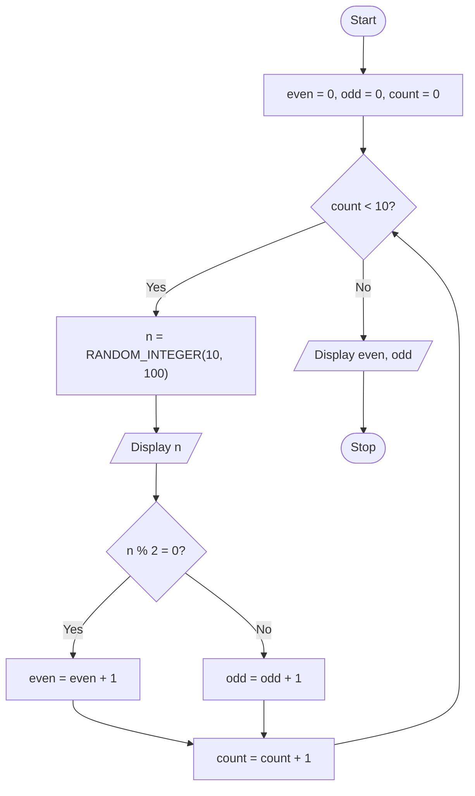
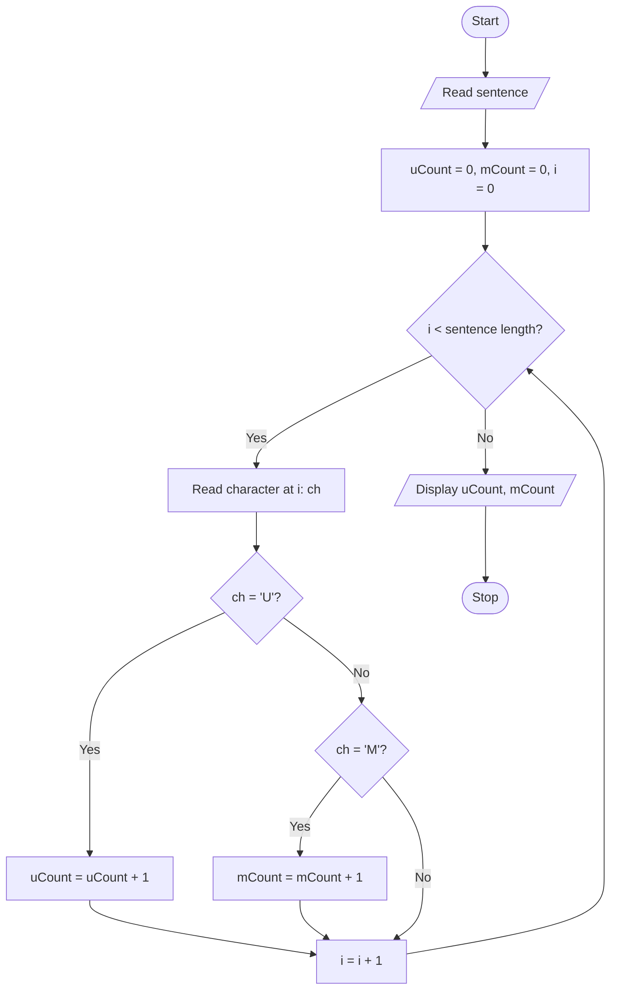

# Tutorial 1

## Part I

### Question 1: Request two numbers from the user and print the multiplication of the numbers.

#### 1. Input-Process-Output (IPO) Model

| Input | Process | Output |
|---|---|---|
| `num1`, `num2` | Multiply `num1` by `num2` | Product |

#### 2. Pseudocode

```text
START
    READ num1
    READ num2
    product ← num1 × num2
    DISPLAY product
STOP
```

#### 3. Flowchart



### Question 2: Determine whether a random number is greater than 50.

#### 1. Input-Process-Output (IPO) Model

| Input | Process | Output |
|---|---|---|
| Random integer `n` (0–100) | Check whether `n > 50` | Number and comparison result |

#### 2. Pseudocode

```text
START
    n ← RANDOM_INTEGER(0, 100)
    IF n > 50 THEN
        DISPLAY n, "Greater than 50"
    ELSE
        DISPLAY n, "Not greater than 50"
    END IF
STOP
```

#### 3. Flowchart



### Question 3: Print the pass/fail grade based on the mark entered by user. The passing mark is at least 40.

#### 1. Input-Process-Output (IPO) Model

| Input | Process | Output |
|---|---|---|
| `mark` | Check whether the mark is valid and determine the grade | Invalid mark, Pass, or Fail |

#### 2. Pseudocode

```text
START
    READ mark
    IF mark < 0 OR mark > 100 THEN
        DISPLAY "Invalid mark"
    ELSE IF mark >= 40 THEN
        DISPLAY "Pass"
    ELSE
        DISPLAY "Fail"
    END IF
STOP
```

#### 3. Flowchart


### Question 4: Print the results of the two players’ dice game.

#### 1. Input-Process-Output (IPO) Model

| Input | Process | Output |
|---|---|---|
| Two generated die values, `p1` and `p2` (1–6) | Compare `p1` and `p2` to determine the winner | Both dice values; winner or draw |

#### 2. Pseudocode

```text
START
    p1 ← RANDOM_INTEGER(1, 6)
    p2 ← RANDOM_INTEGER(1, 6)
    DISPLAY p1, p2
    IF p1 > p2 THEN
        DISPLAY "Player 1 wins"
    ELSE IF p2 > p1 THEN
        DISPLAY "Player 2 wins"
    ELSE
        DISPLAY "Draw"
    END IF
STOP
```

#### 3. Flowchart



### Question 5: Print the perimeter of a rectangle.

#### 1. Input-Process-Output (IPO) Model

| Input | Process | Output |
|---|---|---|
| Length and width in cm | Check whether length and width are valid; calculate perimeter = 2 × (length + width) | Perimeter in cm or an invalid-dimensions message |

#### 2. Pseudocode

```text
START
    READ length, width
    IF length <= 0 OR width <= 0 THEN
        DISPLAY "Invalid dimensions"
    ELSE
        perimeter ← 2 × (length + width)
        DISPLAY perimeter
    END IF
STOP
```

#### 3. Flowchart



### Question 6: Print the minimum number from 10 random numbers generated by computer.

#### 1. Input-Process-Output (IPO) Model

| Input | Process | Output |
|---|---|---|
| 10 generated integers (0–100) | Compare the numbers to find the minimum | The 10 numbers and the minimum number |

#### 2. Pseudocode

```text
START
    minimum ← RANDOM_INTEGER(0, 100)
    DISPLAY minimum
    count ← 1
    WHILE count < 10 DO
        n ← RANDOM_INTEGER(0, 100)
        DISPLAY n
        IF n < minimum THEN
            minimum ← n
        END IF
        count ← count + 1
    END WHILE
    DISPLAY minimum
STOP
```

#### 3. Flowchart



### Question 7: Count the number of odd and even numbers from 10 random numbers generated by the computer.

#### 1. Input-Process-Output (IPO) Model

| Input | Process | Output |
|---|---|---|
| 10 generated integers (10–100) | Check whether each number is even or odd and count them | The 10 numbers, odd count, and even count |

#### 2. Pseudocode

```text
START
    even = 0
    odd = 0
    count = 0
    WHILE count < 10 DO
        n = RANDOM_INTEGER(10, 100)
        DISPLAY n
        IF n % 2 = 0 THEN
            even = even + 1
        ELSE
            odd = odd + 1
        END IF
        count = count + 1
    END WHILE
    DISPLAY even, odd
STOP
```

#### 3. Flowchart



## Part II

### Question 8: Count the number of alphabet U and M from a sentence entered by user.

#### 1. Input-Process-Output (IPO) Model

| Input | Process | Output |
|---|---|---|
| One complete sentence | Inspect each character and count the occurrences of `U` and `M` | Separate `U` count and `M` count |

#### 2. Pseudocode

```text
START
READ sentence
uCount ← 0
mCount ← 0
i ← 0
WHILE i < LENGTH(sentence) DO
    ch ← CHARACTER_AT(sentence, i)
    IF ch = 'U' THEN
        uCount ← uCount + 1
    ELSE IF ch = 'M' THEN
        mCount ← mCount + 1
    END IF
    i ← i + 1
END WHILE
DISPLAY uCount, mCount
STOP
```

#### 3. Flowchart


